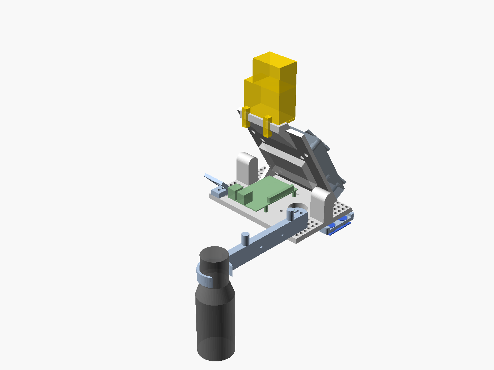

# Desk rig

Printed parts that hang Rho's body from the gas-spring monitor arm with the camera looking straight down at the desk. Designed 8 Nov 2026 from a research pass (arm, boards, sonar physics, mic, brick-compatible printing, rig patterns); the dated numbers are in `docs/log.md` under "Desk rig". The owner's guide with the drawings: "peak — Desk rig guide" (link in `CLAUDE.md`).

`rig.scad` is the one source. `render.sh` writes `stl/` (what the print shop gets), `png/` (previews) and `ballast.dxf` (for a steel shop).



## How it works

| Axis | What holds the camera straight down |
| --- | --- |
| Pitch | The arm's head rests on its face-down tilt stop (about 30°); the carrier's plate leans forward by the same angle, so the shelf is level. Gravity presses the head into the stop: a knock cannot tip it, only lift it off, and a push seats it again. |
| Lift and swing | The gas-strut link is a parallelogram, so the head keeps its angle through the 260 mm of lift; the base, elbow and head swivels are vertical axes. |
| Roll | Friction at the ball joint. Set once with the bubble vial; a paint dot on the dome and one on the plate rim. |
| Residual | Shim washers between the pod's three bosses and the shelf (0.4 mm = 0.3°). The GY-521 on the pod reports pitch and roll so the mind can warn. |

The sonar hangs on an outrigger under the right wing, cans down, moved in 8 mm steps on the grid until its 350 mm spot (at 650 mm) lands on bare desk. Its height reading, temperature-corrected, gives the camera's mm per pixel: `mm/px = height / 818` on the 1920x1080 stream (0.79 mm/px at 650 mm).

## Parts to print

PETG, light grey or white (not dark: the rig hangs by a window), 0.4 mm nozzle, 0.2 mm layers, 4 walls, no supports. Print the coupon first, on the same spool and settings, and read it before the carrier goes on.

| Part | Holds | File | Orientation | Infill | ~g |
| --- | --- | --- | --- | --- | --- |
| Carrier | Everything: VESA plate, shelf, Pi inserts, the 8 mm grid on both wings, Rho's perch, backrest, two horns to lift by | `stl/carrier.stl` | As exported: shelf underside on the bed, plate leaning 30° (a 30° overhang) | 20 % | 230 |
| Measurement pod | Camera Module 3 Wide (lens down), GY-521, 25 mm bullseye vial | `stl/pod.stl` | Bottom (desk-facing) face on the bed: it is the datum | 40 % | 36 |
| Sonar outrigger | HC-SR04+ in a recess, cans through Ø18 holes, never touching plastic | `stl/outrigger.stl` | As exported (baffle face down, recess open on top) | 40 % | 10 |
| Mic bar | Foam-lined C-ring on a 150 mm bar on the right wing, two posts to coil the lead on | `stl/micbar.stl` | As exported: standing on its 10 mm face, posts up | 20 % | 30 |
| PIR visor | HC-SR501 on a 45° face looking down at the chair, two grid pins in its foot | `stl/pirwedge.stl` | Foot down | 20 % | 5 |
| OLED sled | The 0.96" module upright inside Rho's brick-built head | `stl/sled.stl` | Flat, pegs up | 100 % | 1 |
| Shim washers | 4 each of 0.4, 0.8 and 1.6 mm for trimming the pod | `stl/shims.stl` | Flat | 100 % | 1 |
| Fit coupon | Pin holes 4.8–5.1, both insert bores, nut pocket, can hole, a horizontal pin hole | `stl/coupon.stl` | Flat | 20 % | 15 |

About 330 g in all. Taito 3D (41 Juta St, Braamfontein, WhatsApp 082 638 6363, 24 h turnaround, no minimum) lists PET-G; ask whether they press inserts.

## Measure first

All on the desk, before anything goes to the shop. Each one is a named parameter at the top of `rig.scad`.

| Measurement | Parameter | Expected | Why |
| --- | --- | --- | --- |
| Push the VESA plate to its face-down stop, phone level flat on it, release, bump, re-read, five times | `STOP_DEG` | 30° ± 3°, repeatable within 0.5°. Usable 0–40°. Not repeatable or steeper: `STOP_DEG = 0` (plate vertical, friction-held) | Sets the plate's lean |
| Phone level on the plate from the bottom to the top of the lift, and swung end to end | – | The reading must not move | Proves the parallelogram |
| The arm's steel X-plate: span, thickness, anything proud at its centre | – | Under 150 mm, 2–2.6 mm; the ballast has a Ø45 relief | The carrier's plate is 120 wide |
| Mic: diameter of the neck above the red ring, and the straight length of that neck | `mic_waist`, `ring_len` | about 36 mm; ring 15 mm | Ring ID = waist + 3 |
| OLED module: outline, hole spacing and diameter, header perpendicular or in-plane, where the lit area starts | `oled_*` | 27.3 × 27.8, holes 22.3 × 23.0 Ø2.8 | The sled |
| HC-SR04+: can diameter and spacing, tallest part on the back of the board | `can_d`, `can_pitch`, `sonar_back` | 16, 26, 2.5 | Ø18 holes, 5 mm recess |
| GY-521 hole spacing | `gy_pitch` | 15.5 | |
| From the coupon: which hole grips a Technic pin yet pulls out by hand | `pin_hole` | 4.9 | The grid and the backrest |
| What lies under the sonar at the usual arm position | – | Bare desk in a 350 mm circle (the strip behind the keyboard) | Else move the outrigger a grid hole |
| Seated, arm at working height: mouth to the mic ring | `bar_len` | 40–55 cm | |

## Fasteners and bits

| Item | Qty | Where | ZAR |
| --- | --- | --- | --- |
| Heat-set insert M4 × L5 × OD6 | 3 (+2 spare) | PiShop | 2.50 ea |
| Heat-set insert M2.5 × L4 × OD3.5 | 4 (+2 spare) | PiShop | 3.50 ea |
| M2.5 M/F brass standoff 11 mm | 4 | PiShop | 3.99 ea |
| M2.5 × 6 cheese head | 4 | PiShop | 0.90 ea |
| M2 × 6 cheese head (camera 4, PIR 2) | 10 | PiShop | 0.70 ea |
| M3 × 6 | 2 | PiShop / Communica | ~1.50 ea |
| M4 socket cap: × 30 (VESA, with ballast) ×4, × 10 (VESA, without) ×4, × 16 ×3 (pod), × 20 ×2 (outrigger); M4 × 40 button ×2 and nyloc ×2 (mic bar); DIN 934 M4 nuts ×10; M4 washers ×6 | 1 lot | Builders Warehouse | ~150 |
| Hex key set with ball ends (the arm's tension screw wants a 5 mm ball end) | 1 | Builders Warehouse | ~80 |
| Technic pin with friction 2780 | 4 | BrickLink / the parts bag | |
| Cable ties 3 × 100, 50-pack | 1 | PiShop | 59.90 |
| Self-adhesive foam tape 2 mm (mic ring liner) | 1 roll | Builders Warehouse | ~40 |
| CA glue (perch plate, vial) | 1 | Any | ~30 |
| Bullseye bubble level 25 mm (optional: the GY-521 is the level) | 1 | Takealot / AliExpress | 60–150 |
| Vernier caliper 150 mm | 1 | PiShop | 143.54 |
| Ballast, see below | | | |

PiShop prices read 7–8 Nov 2026; the rest are estimates.

## Ballast

The arm's gas spring lifts at least 2 kg. The rig weighs about 0.7 kg, so without ballast the arm floats to its top stop and cannot be set to a height (that is why it sits high in the 7 Nov photo). Two routes, in order:

1. **This week:** two 1 kg strap weights (Trojan ankle weights, Takealot, R439 a pair) hung over the horns or through the X-plate's upper lobes, at the head, never down the link. Then turn the 5 mm hex screw under the upper arm at the elbow toward "−" with everything attached until the arm holds at any height.
2. **Permanent:** `ballast.dxf`, a 120 × 120 × 20 mm mild-steel plate (about 2.0 kg) with a Ø45 centre hole and Ø4.5 holes on the 75 and 100 patterns, sandwiched between the X-plate and the carrier. Any Johannesburg laser-cutting shop takes the DXF. The carrier's VESA bolts then become M4 × 30; re-set the tension screw.

Never take the ballast off with the arm below its top stop: it springs up.

## Assembly

1. Desk: the stop and parallelogram tests above; set `STOP_DEG`; measure the rest; `./render.sh`.
2. Shop: print the coupon; try a 2780 pin in the four holes, both inserts, a nut, an M4 bolt, a sonar can. Set `pin_hole`, re-render, print the rest.
3. Desk: press the inserts with the soldering station at 230–240 °C, flat tip, 3 s each: 4 × M2.5 in the shelf, 3 × M4 in the pod's bosses. Glue the real 4×8 plate studs-up into the perch pocket. Drop M4 nuts into the carrier's VESA pockets, a dab of CA on each.
4. Desk: carrier onto the arm: 4 × M4 from the arm side through the X-plate's 75 holes (and the ballast) into the carrier's nuts. Head pushed down onto its stop, 0° rotation.
5. Desk: Pi bare (out of the snap case) on the 11 mm standoffs, SD edge toward the plate, HDMI edge to the right, 4 × M2.5 × 6. One cable tie round the rear-right standoff holds the camera ribbon's vertical run.
6. Desk: camera into the pod (4 × M2 × 6, PCB face flat on the pocket floor, cable edge toward the plate), GY-521 on 2 × M3, vial glued. Pod under the shelf on 3 × M4 × 16 with washers. Ribbon: back 9 mm along the pod, up through the shelf slot, over the Pi, down into the CSI port (about 130 of the 200 mm).
7. Desk: sonar board into the outrigger's recess, two cable ties over its ends; outrigger under the right wing on grid (24,64) and (40,64), 2 × M4 × 20 into its nut pockets. Header housings out past the wing's edge.
8. Desk: PIR visor on two pins at grid (104,−72) and (112,−72); board on top, dome through the hole, 2 × M2 × 6. Set its pots first.
9. Desk: mic bar on grid (96,72) and (112,72), 2 × M4 × 40 and nylocs under the wing. Foam in the ring, mic in from the right, lead six turns round the posts, tied.
10. Desk: breadboard stuck to the plate's front face above the Pi as the 3V3/GND/SDA/SCL hub (pins 1, 9, 3, 5; never pins 2 or 4 on those rails). OLED and GY-521 on it (0x3C and 0x68). Sonar on 17/20/16/18, PIR on 2/6/11 as today. DS18B20 (KY-001 from the sensor kit) under the left wing: pin 7, 3V3, pin 25.
11. Desk: push the rig into the stop, roll until the vial centres, paint the two dots. Read the GY-521; shim a boss if over 0.5°.
12. Rho onto the perch, two pins through the backrest into his Technic 1×8, leads out of the head's back gap, down behind the backrest to the breadboard.
13. Desk: tension screw toward "−" until the arm holds at any height.

## Rho's body

Real bricks; nothing printed carries clutch (a shop print lands ±0.2 mm, which is the whole clutch budget). The printed sled holds the OLED upright behind a Window 1×4×3 frame (60594) in a 6×4-stud head on an 8×4 torso, legs dangling over the front edge, the minifig pilot on a seat on the free shoulder. Full parts list in the guide. The lit area's bottom edge must sit 10 mm above the head's floor to clear the window sill from the chair: measure the module, set `oled_ear`. Header-down needs `img.transpose(Image.Transpose.ROTATE_180)` before `oled.pack(img)` in `node/servod.py`.

## Software that follows

- `node/servod.py`: `height_mm` from the sonar with `distance × (331.3 + 0.606·T) / 343.26` (T from the DS18B20), median of 9, a `settled` flag; pitch and roll from the GY-521.
- `mind/senses/presenceFilter.js`: "near" becomes the height dropping 100 mm below the settled height for 0.5 s; today's 30 cm rule can never fire from 60 cm up.
- `mind/.env`: `PEAK_DESK_ROTATE=none` (cable edge toward the arm already puts the chair at the top of the frame); re-score `mind/bakeoff/desk` on a new recording.
- Scale: a ChArUco calibration of the Wide lens on the Mac (5×7, 40 mm squares), then `mm/px = height / 818` on the 1080p stream; a 60 mm ArUco on a desk corner as the check.
- `mind/senses/hearing.js`: drop utterances that start while a `say` is in flight plus 1 s (the omni mic hears the HomePod).

## Rendering

```
brew install --cask openscad@snapshot --appdir=~/Applications   # once; the stable cask is disabled
./render.sh
```

Licences: the SCAD is original, GPL-3 like the repo. Nothing was copied from Thingiverse or Printables. File names say "brick-compatible", not the trademark.
